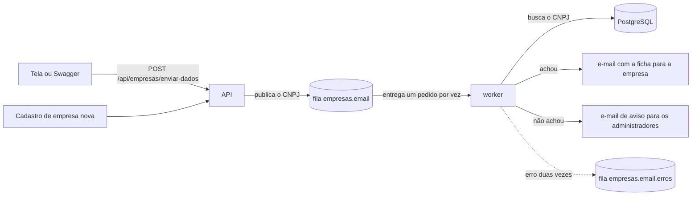

# Filas e mensageria

[Voltar ao README](../README.md)

## O que tem no projeto

Um container do RabbitMQ e um worker (`api/worker.js`), que é um programa separado da API, rodando no
seu próprio container. A API coloca pedidos na fila e o worker vai tirando e processando um por um.



Cada mensagem é um JSON simples:

```json
{ "cnpj": "11.222.333/0001-81", "solicitadoPor": "Ana Souza", "solicitadoEm": "2026-11-18T14:02:11.000Z" }
```

O pedido entra na fila de dois jeitos:

- pelo botão "Enviar dados por e-mail" no cadastro da empresa (ou pela rota no Swagger);
- sozinho, quando uma empresa nova é cadastrada. Ela recebe a confirmação com os dados por e-mail.

O segundo é a melhoria que fiz no desafio. Mandar e-mail é lento (o Gmail demora de 1 a 2 segundos) e às
vezes falha. Com a fila, o cadastro responde na hora e o e-mail sai em segundo plano. Se o e-mail falhar, o
cadastro não é perdido nem desfeito.

## Os conceitos básicos

- **Produtor**: quem coloca a mensagem na fila. Aqui é a API (`api/fila.js`).
- **Consumidor**: quem tira a mensagem e faz o trabalho. Aqui é o worker.
- **Broker**: o servidor que guarda as filas e entrega as mensagens. Aqui é o RabbitMQ.
- **Fila durável** (`durable: true`): a fila continua existindo se o RabbitMQ reiniciar.
- **Mensagem persistente** (`persistent: true`): a mensagem é gravada em disco, então também sobrevive a
  um reinício. Uma fila durável com mensagens não persistentes perde as mensagens mesmo assim.
- **Prefetch**: quantas mensagens o consumidor pode receber antes de confirmar as anteriores. O worker usa
  1, então pega uma, termina e só então recebe a próxima.

## Os dois jeitos de tirar a mensagem da fila

É o ponto que o orientador citou. No RabbitMQ isso não é um tipo de fila. É o jeito como o consumidor lê
(o modo de confirmação, ou "ack"):

| | Confirmação automática (`noAck: true`) | Confirmação manual (`noAck: false`) |
| --- | --- | --- |
| Quando a mensagem sai da fila | Assim que é entregue ao consumidor | Só quando o consumidor chama `ack()` |
| Se o consumidor cair no meio do trabalho | A mensagem se perde | O RabbitMQ devolve a mensagem para a fila |
| Bom para | Coisas que podem se perder (métricas, logs de baixa importância) | Trabalho que precisa acontecer (e-mail, pagamento, pedido) |

O worker usa a confirmação manual. Ele manda o e-mail e só depois chama `ack()`. Se o container cair no
meio do envio, o pedido volta para a fila e outro worker (ou o mesmo, quando voltar) processa de novo.

Dá para ver a diferença funcionando:

```bash
docker compose exec worker node filas-demonstracao.js
```

O script publica uma mensagem, lê com confirmação automática e "cai" antes de terminar: a mensagem some.
Depois faz o mesmo com confirmação manual: a mensagem volta para a fila e só sai quando ele chama `ack()`.

Também existem dois jeitos de receber: o consumidor pode **pedir** uma mensagem quando quiser (`get`, como
faz a demonstração) ou se **inscrever** e o RabbitMQ vai **empurrando** as mensagens conforme chegam
(`consume`, como faz o worker).

## Quando dá erro: nova tentativa e fila de erros

Se o envio do e-mail falhar (por exemplo, o Gmail fora do ar), o worker faz `nack` e devolve a mensagem para
a fila para tentar de novo depois de 5 segundos. Se falhar pela segunda vez, a mensagem vai para a fila
`empresas.email.erros`. Esse tipo de fila se chama **dead-letter** (fila de "cartas mortas"): guarda o que
não deu para processar, para alguém olhar depois, sem travar a fila principal tentando a mesma mensagem para
sempre. Uma mensagem que nem é um JSON válido vai direto para lá.

As mensagens da fila de erros aparecem no painel do RabbitMQ, em http://localhost:15672 (aba Queues).

## Fila é a mesma coisa que mensageria?

Não exatamente. **Mensageria** é o assunto maior: sistemas conversando por mensagens, passando por um
intermediário, sem um esperar a resposta do outro na hora. **Fila** é um dos jeitos de fazer mensageria.

| Padrão | Como funciona | Exemplo |
| --- | --- | --- |
| Fila (ponto a ponto) | Cada mensagem é processada por **um** consumidor e depois sai | Este projeto: cada pedido vira um e-mail, uma vez só |
| Publicação/assinatura (pub/sub, tópicos) | Cada mensagem é **copiada** para todos os interessados | "Empresa cadastrada" indo ao mesmo tempo para e-mail, financeiro e relatórios |
| Stream (log) | As mensagens **ficam guardadas** em ordem; cada consumidor lê no seu ritmo e lembra onde parou | Kafka: histórico de eventos que vários sistemas releem |

O RabbitMQ faz os três. Filas são o uso mais comum, os "exchanges" do tipo fanout e topic fazem o pub/sub, e
desde a versão 3.9 ele tem streams. O Kafka nasceu como stream.

## Serviços de fila mais usados

| Serviço | De quem | Tipo | O "tirar da fila" |
| --- | --- | --- | --- |
| RabbitMQ | Open source (roda em qualquer lugar; versões gerenciadas: Amazon MQ, CloudAMQP) | Filas, pub/sub e streams | Ack automático ou manual |
| Amazon SQS | AWS | Fila | Ao receber, a mensagem fica escondida por um tempo (visibility timeout, 30 s por padrão). Se ninguém chamar `DeleteMessage`, ela volta |
| Amazon SNS | AWS | Pub/sub | Entrega para todos os assinantes. É comum ligar SNS em várias filas SQS |
| Amazon EventBridge | AWS | Barramento de eventos | Roteia eventos por regras para outros serviços |
| Amazon Kinesis | AWS | Stream | Não remove; cada leitor guarda sua posição |
| Amazon MSK | AWS | Kafka gerenciado | Igual ao Kafka |
| Azure Queue Storage | Azure | Fila simples | Parecido com o SQS: some por um tempo e precisa ser apagada |
| Azure Service Bus | Azure | Filas e tópicos | Tem os dois modos com nome: **ReceiveAndDelete** (sai ao ler) e **PeekLock** (fica travada até o `Complete`) |
| Azure Event Hubs | Azure | Stream | Aceita o protocolo do Kafka |
| Azure Event Grid | Azure | Eventos | Avisa outros serviços quando algo acontece |
| Google Pub/Sub | GCP | Pub/sub | O assinante tem um prazo para confirmar (ack deadline); se não confirmar, recebe de novo |
| Google Cloud Tasks | GCP | Fila de tarefas | Chama uma URL para cada tarefa, com novas tentativas |
| Google Managed Service for Apache Kafka | GCP | Kafka gerenciado | Igual ao Kafka |
| Apache Kafka | Open source (criado no LinkedIn); versões gerenciadas: Confluent Cloud, Amazon MSK, Google | Stream | Não remove ao ler: o consumidor grava até onde leu (offset), automático ou manual |
| Redis, NATS, ActiveMQ, Pulsar | Open source | Variados | Redis tem listas e streams (no Node, a biblioteca BullMQ usa Redis como fila) |

Então o Kafka não é de nenhuma nuvem. É um projeto open source da Apache que as nuvens oferecem pronto
(AWS e Google com o Kafka em si, Azure com o Event Hubs falando o mesmo protocolo).

O "ack manual" aparece em todos com nomes diferentes: `ack()` no RabbitMQ, `DeleteMessage` no SQS,
`Complete` no Service Bus, ack no Pub/Sub e commit do offset no Kafka. A ideia é sempre a mesma: só dar a
mensagem como resolvida depois que o trabalho terminou.

## Como testar

1. Abra o painel do RabbitMQ em http://localhost:15672 (usuário `cadastrohub`, senha `cadastrohub123`) e
   vá em Queues. Estão lá `empresas.email` e `empresas.email.erros`.
2. No sistema, abra uma empresa e clique em "Enviar dados por e-mail". Em instantes o e-mail aparece no
   Mailpit (http://localhost:8025).
3. No Swagger (http://localhost:3000/api/docs), use `POST /empresas/enviar-dados` com um CNPJ que não existe,
   como `99.999.999/0001-99`. O aviso vai para os administradores.
4. Para ver as mensagens se acumulando, pare o worker (`docker compose stop worker`), mande alguns pedidos e
   olhe o painel. Ao ligar de novo (`docker compose start worker`), ele processa tudo o que ficou.
5. O que o worker fez aparece no log: `docker compose logs -f worker`.

## Outras ideias de uso aqui

- Mandar todos os e-mails do sistema pela fila (código de acesso, recuperação de senha, aviso semanal),
  para nenhuma tela esperar o Gmail.
- Gerar planilhas grandes em segundo plano e avisar quando ficarem prontas.
- Publicar "empresa cadastrada" como pub/sub, para outros sistemas (financeiro, CRM) ficarem sabendo.
