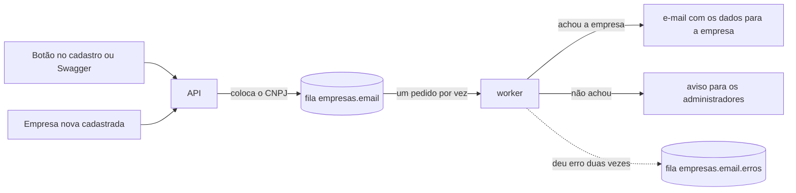

# Filas e mensageria

[Voltar ao README](../README.md)

## A ideia, com uma padaria

Sem fila, o atendente anota o pedido, vai até a cozinha e espera o pão ficar pronto antes de atender o
próximo. Com fila, ele prende o pedido num espeto e já atende o próximo cliente. O padeiro vai tirando os
pedidos do espeto, um de cada vez.

No projeto, o atendente é a API, o espeto é a fila do RabbitMQ e o padeiro é o worker (`api/worker.js`), um
programa separado da API que roda no seu próprio container. Mandar e-mail é lento e às vezes falha. Com a
fila, a tela responde na hora e o e-mail sai depois, sem ninguém esperar.

## O que acontece no projeto



O pedido entra na fila de dois jeitos: pelo botão "Enviar dados por e-mail" no cadastro da empresa, ou
sozinho quando uma empresa nova é cadastrada. Esse segundo foi a melhoria que fiz no desafio: a empresa
recebe a confirmação dos dados por e-mail e o cadastro não fica esperando o e-mail sair.

Cada mensagem da fila é só um JSON:

```json
{ "cnpj": "11.222.333/0001-81", "solicitadoPor": "Ana Souza", "solicitadoEm": "2026-11-18T14:02:11.000Z" }
```

O worker pega o CNPJ e procura no banco. Se achar a empresa, manda a ficha com os dados para o e-mail dela.
Se não achar, ou se a empresa estiver excluída, avisa os administradores.

## Algumas palavras que aparecem

- Produtor é quem coloca a mensagem na fila. Aqui é a API (`api/fila.js`).
- Consumidor é quem tira e faz o trabalho. Aqui é o worker.
- Broker é o servidor que guarda as filas. Aqui é o RabbitMQ.
- Fila durável é a que continua existindo se o RabbitMQ reiniciar. Mensagem persistente é a que fica gravada
  em disco e também sobrevive. Usei as duas coisas, senão os pedidos sumiriam num reinício.
- Prefetch é quantas mensagens o worker pega de uma vez. Coloquei 1: ele pega uma, termina e só então
  recebe a próxima.

## Os dois jeitos de tirar da fila

No RabbitMQ isso não é um tipo de fila, é o jeito como o consumidor lê.

No **ack automático** (`noAck: true`), a mensagem sai da fila assim que é entregue. É como o padeiro jogar
o papel do pedido fora na hora que pega. Se ele passar mal antes de fazer o pão, o pedido some. Serve para
coisas que podem se perder sem problema, como uma métrica.

No **ack manual** (`noAck: false`), a mensagem fica reservada até o consumidor dizer "terminei" (o `ack()`).
É como o padeiro só jogar o papel fora depois de entregar o pão. Se ele passar mal no meio, o papel volta
para o espeto e outro faz.

O worker usa o manual: manda o e-mail e só depois chama `ack()`. Dá para ver a diferença acontecendo com:

```bash
docker compose exec worker node filas-demonstracao.js
```

O script lê uma mensagem do jeito automático e "cai" antes de terminar, e ela some. Depois faz o mesmo do
jeito manual, e a mensagem volta para a fila.

Tem também duas formas de receber: o consumidor pode pedir uma mensagem quando quiser (`get`, como faz a
demonstração) ou ficar ouvindo e o RabbitMQ vai mandando conforme chegam (`consume`, como faz o worker).

## Quando dá erro

Se o e-mail falhar (o Gmail fora do ar, por exemplo), o worker devolve a mensagem para a fila (o `nack`) e
tenta de novo depois de 5 segundos. Se falhar de novo, ela vai para a fila `empresas.email.erros`.

Essa fila de erros se chama dead-letter. Sem ela, uma mensagem com problema ia ser tentada para sempre e
travar as outras. Uma mensagem que nem é JSON vai direto para lá. Dá para ver o que caiu nela no painel do
RabbitMQ, em http://localhost:15672.

Um detalhe que apareceu nos testes: o worker usa os dados do momento em que lê a fila, não do momento do
pedido. Se a empresa for excluída enquanto o pedido espera, ele avisa os administradores em vez de mandar
para a empresa. Isso se chama consistência eventual.

## Fila é a mesma coisa que mensageria?

Não. Mensageria é o assunto geral, sistemas conversando por mensagens através de um intermediário, sem um
esperar o outro. Fila é um dos jeitos de fazer isso. Os três mais comuns:

- Fila: cada mensagem é tratada por um consumidor só e depois sai. É o que fiz aqui, cada pedido vira um
  e-mail, uma vez.
- Pub/sub (publicação e assinatura): a mensagem é copiada para todos os interessados. Por exemplo, "empresa
  cadastrada" indo ao mesmo tempo para o e-mail, o financeiro e os relatórios.
- Stream: as mensagens ficam guardadas em ordem e cada um lê no seu ritmo, lembrando onde parou. É o caso do
  Kafka.

O RabbitMQ faz os três. O Kafka nasceu como stream.

## Os serviços mais usados

Cada nuvem tem os seus. Os que mais aparecem:

| Serviço | De quem | Em uma frase |
| --- | --- | --- |
| RabbitMQ | Open source | O que usei aqui. Faz fila, pub/sub e stream |
| SQS | AWS | Fila simples e muito usada |
| SNS | AWS | Pub/sub. É comum ligar o SNS em várias filas SQS |
| EventBridge | AWS | Recebe eventos e manda para outros serviços por regras |
| Kinesis e MSK | AWS | Streams. O MSK é o Kafka pronto da AWS |
| Queue Storage | Azure | Fila simples, parecida com o SQS |
| Service Bus | Azure | Filas e tópicos, mais completo |
| Event Hubs | Azure | Stream, e aceita programas feitos para o Kafka |
| Pub/Sub | Google | Pub/sub |
| Cloud Tasks | Google | Fila de tarefas que chama uma URL para cada uma |
| Kafka | Open source (Apache) | Stream. Nasceu no LinkedIn |

O Kafka não é de nenhuma nuvem. É um projeto open source da Apache, mas a AWS (MSK) e o Google oferecem ele
pronto, e o Event Hubs do Azure entende o mesmo protocolo. Também existem outros, como Redis, NATS e
ActiveMQ.

O "ack manual" existe em todos, com nomes diferentes. No SQS a mensagem fica escondida por um tempo depois
de lida e volta se ninguém apagar. No Pub/Sub do Google tem um prazo para confirmar. No Kafka nada é
apagado: o consumidor anota até onde já leu. E o Service Bus do Azure tem os dois modos com nome:
ReceiveAndDelete (sai ao ler) e PeekLock (fica travada até confirmar).

## Como testar

1. Abra o painel do RabbitMQ em http://localhost:15672 (usuário `cadastrohub`, senha `cadastrohub123`) e
   entre em Queues and Streams. Estão lá `empresas.email` e `empresas.email.erros`.
2. Abra uma empresa no sistema e clique em "Enviar dados por e-mail". O e-mail aparece no Mailpit
   (http://localhost:8025) em instantes.
3. No Swagger (http://localhost:3000/api/docs), mande um CNPJ que não existe em `POST /empresas/enviar-dados`,
   como `99.999.999/0001-99`. O aviso vai para os administradores.
4. Para ver os pedidos se acumulando, pare o worker, mande alguns pedidos e olhe a coluna Ready no painel.
   Quando ligar de novo, ele processa tudo o que ficou:

   ```bash
   docker compose stop worker
   docker compose start worker
   ```

5. O que o worker fez aparece no log:

   ```bash
   docker compose logs -f worker
   ```

## Outras ideias para usar fila aqui

- Mandar todos os e-mails do sistema pela fila (código de acesso, recuperação de senha, aviso semanal), para
  nenhuma tela esperar o Gmail.
- Gerar planilhas grandes em segundo plano e avisar quando ficarem prontas.
- Publicar "empresa cadastrada" como pub/sub, para outros sistemas ficarem sabendo.
